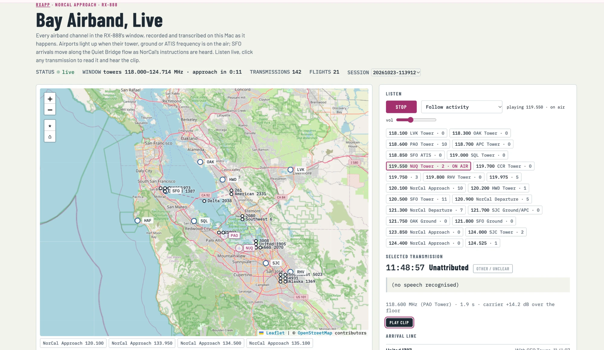
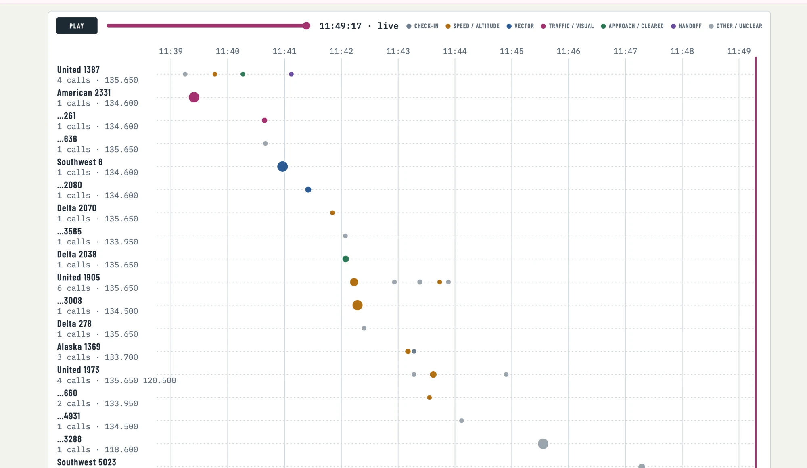

# rxapp

A browser SDR and monitoring app for the RX-888, built on ka9q-radio's `radiod` (the macOS port in
[`../ka9q`](../ka9q/README.md)). `radiod` owns the radio and demodulates any number of channels at once;
rxapp is its only client.

```
RX-888 ─USB─▶ radiod ──multicast (loopback)──▶ rxapp (FastAPI) ──HTTP/WebSocket──▶ browser
                status/commands 5006, RTP audio 5004
```

## Run

```bash
./run_rxapp.sh            # starts radiod too if it isn't running; open http://127.0.0.1:8090
```

To run it at login and keep it running: see `service/com.rx888.rxapp.plist` (a LaunchAgent).
Only one program can use the RX-888, so stop rxapp before using SDR++, ka9q-web's radiod session
or the SoapySDDC scripts.

## What it does

| | |
|---|---|
| **Inputs** | **HF** (direct sampling) or **VHF** (the R828D tuner, 24–1700 MHz), switched from the page. HF **coverage** 0–32 MHz (radiod at 64.8 MS/s) or 0–64 MHz (129.6 MS/s, ~90% of one core); switching restarts radiod and restores the channels. |
| **Listen** | A 2 × 2 grid of spectrum + waterfall panels, each on its own range: presets (0–2 MHz, 2–30 MHz, amateur and broadcast bands, FM, airband, 2 m, VHF-high, marine, NOAA, UHF 400–470, 70 cm, FRS/GMRS) or a custom range. Defaults: 0–2 MHz, 2–30 MHz, airband, UHF 400–470 MHz; the choice is kept in the browser. The receiver sees one input at a time. On HF every HF panel is live, each with its own radiod spectrum channel (2048 bins, 5 fps). On VHF only the tuner's 8.4 MHz window is live (shaded on VHF panels). The rest of each panel keeps the last picture, greyed, and the panel says how old it is ("seen 4 min ago · receiver on VHF"); it catches up whenever the voice session or you move the receiver there. Click a panel to tune; it switches the input or moves the tuner if needed, and pauses the voice session. ←/→ or the wheel step (Shift ×10). (`/ws/panels`, `rxapp/panels.py`.) **Gain**: HF −41.5…+34 dB (below −10 dB the attenuator) or Auto; VHF tuner IF gain 0–15. HF modes AM, SAM, USB, LSB, CW, NFM; VHF modes WFM, NFM, AM. Audio in the browser over a WebSocket, S-meter and SNR. |
| **Channels** | Any number at once (radiod demodulates them all); the Radio page tunes and records one, the other pages make their own. |
| **Scan** | HF: AM broadcast, shortwave broadcast bands, ham bands (peak finding for SSB), CB, WWV propagation check. VHF: FM broadcast, airband, 2 m, NOAA weather; bands wider than the tuner window are scanned in steps (FM: 4 steps, ~25 s), which briefly moves the tuner. HF scans use their own spectrum channel, so the display doesn't move. Run from the AM / SW / FM and SSB Voice pages, or `POST /api/scan/{band}`. |
| **Monitor** (server-side) | Scheduled scans (default: AM every 10 min, WWV every 30 min) and *watches*: a channel recorded automatically whenever its SNR rises above a threshold, optionally transcribed on-device. API: `/api/schedules`, `/api/watches`, `/api/recordings`. |
| **FT8** (server-side) | Every FT8 band at once (160 m–10 m, plus 6 m with 0–64 MHz coverage): one USB channel per dial frequency, cut into 15 s UTC slots and decoded with ft8_lib. Shown on the FT8 / FT4 page (map and per-station timeline). Keeps running across restarts; pauses while VHF is selected. |
| **Airband** (with `voice_session.py`) | Every airband channel in the tuner's 8.4 MHz window recorded and transcribed at once, alternating between the NorCal approach and Bay Area tower windows; a live map page with all Bay Area airports. See [Airband](#airband). |
| **Public safety** (with `voice_session.py`) | CHP's low band (HF input) and VHF-high conventional channels, recorded and transcribed; digital transmissions logged, not decoded; 7-day retention. See [Public safety](#public-safety). |
| **SSTV** (server-side) | Watches the SSTV calling frequencies (3.845 and 7.171 MHz LSB; 14.230, 14.233, 21.340, 28.680 MHz USB) and decodes every picture into a gallery, with the audio kept. |
| **History** | Occupancy per channel, detections over time, receiver health (IF power, RF gain, spectrum rate, ADC overloads), event log: `/api/occupancy/{band}`, `/api/timeline/{band}`, `/api/health/history`, `/api/events`. |
| **SSB voice** | Known HF voice channels (amateur nets and calling frequencies, Pacific aviation and VOLMET, USAF HFGCS, Coast Guard) with a voice-band signal check, and conversations found anywhere in the amateur phone bands. See [SSB voice](#ssb-voice). |
| **Recovery** | A supervisor restarts radiod when it stops answering (USB unplug, crash) and re-creates every channel with the same SSRC; open pages reconnect and re-create their channel. |

## How VHF works with radiod

radiod's RX-888 driver has no working VHF support ("VHF tuner does not work yet"), but it doesn't need
it: radiod keeps sampling the ADC as on HF, and rxapp flips the RX-888's antenna switch to the tuner and
programs the R828D over USB control transfers (`rxapp/vhf.py`, using ka9q-radio's
`rx888_vhf_demo/rx888_vhf.py`). The tuner mixes the wanted signal to a 4.57 MHz IF with its LO above the
signal, so the IF spectrum is inverted:

    radiod frequency = 4.57 MHz − (RF − tuner centre)       (USB/LSB swap)

Channels keep their real frequency and band; rxapp maps them, flips and relabels the spectrum, and moves
the tuner when you tune outside its ±4.2 MHz window (channels outside the window pause until it returns).
The tuner's LNA and mixer run on their own AGC with the IF VGA at 6 (adjustable, "Tuner gain"); radiod's
RF AGC then holds the ADC at about −20 dBFS. Expect a burst of ADC overloads for a second or two right
after switching to VHF while radiod's AGC settles. Channels that stop producing audio for 5 s (seen once,
right after a switch) are re-created automatically.

Channels of the input not in use are *parked* (kept by rxapp, absent from radiod); HF watches and HF scan
schedules pause while VHF is selected, and the other way round.

## HF gain

Manual gain goes to radiod as RF gain (AD8370) plus attenuation (PE4312). radiod's own RF AGC turns
off for good after the first manual command, so **Auto** is rxapp's AGC (`rxapp/hfgain.py`), holding the
ADC between −26 and −15 dBFS like radiod's. The same amplifier sits in the VHF tuner's IF path, so on VHF
the gain is always automatic and a manual HF value comes back when you return to HF.

## FT8

Needs ft8_lib's decoder, built into `tools/ft8_lib` (not committed):

```bash
git clone --depth 1 https://github.com/kgoba/ft8_lib.git tools/ft8_lib
make -C tools/ft8_lib decode_ft8 CFLAGS="-O3 -DHAVE_STPCPY -I. -include stdio.h"   # stdio.h: current macOS SDKs
```

Slot timing comes from RTP timestamps, anchored to the wall clock by the least-delayed packet, and
corrected for radiod's ~0.3 s filter delay; measured decode `dt` is centred on 0 like WSJT-X. The host
clock must be right (macOS keeps it NTP-synced). `score` is ft8_lib's rough SNR estimate, not WSJT-X's.
Decodes are in the `ft8` table of `rxapp_data/rxapp.sqlite`; the audio isn't kept.

**FT8 Skywatch** (`/ft8.html`, linked from the FT8 tab) shows the decodes like the
[airband page](https://minyaozhu.github.io/malahit-airband-monitor/): a world map (stations at their grid
centre, coloured by band; hollow when placed only by callsign prefix; lines from each station to the one
it's calling; rings for CQ) and a timeline with one lane per station, dots coloured by message phase
(CQ → answer + grid → report → roger + report → RR73/73). Scrub or Play to replay a window of 15 min to
24 h; at the end of the slider it follows live. Click a dot or station to read the message in plain
English, with distance from your locator ("Home", default CM87; `POST /api/ft8/qth`). The map libraries
(d3, topojson, world-atlas) load from jsDelivr, so the page needs internet.

API: `GET/POST /api/ft8` (status / `{on, bands}`), `GET /api/ft8/decodes?after_id=`,
`GET /api/ft8/conversations?hours=`, `GET /api/ft8/stats?hours=`.

## FT4

The FT8 monitor also runs as an FT4 monitor (`Ft8(..., proto=FT4)`): 7.5 s slots on the FT4 dial frequencies
(3.575, 7.0475, 10.140, 14.080, 18.104, 21.140, 24.919, 28.180, 50.318 MHz), `decode_ft8 -ft4`, table `ft4`, API
`/api/ft4/...` (the same endpoints as FT8). Each slot is decoded twice, the second time with its first 0.4 s cut
(the Malahit toolkit found ft8_lib's FT4 decoder missing signals that start later than ~0.5 s into the file);
the results are merged. Tested end to end with a signal from ft8_lib's `gen_ft8 -ft4`. FT4 is shown
on the FT8 / FT4 page (`ft8.html?proto=ft4`, the page's FT8 / FT4 switch); each mode has a Start/Stop for its monitor.

## SSTV

Each SSTV channel's last 20 s of audio is checked every 5 s with the Malahit toolkit's detector
(energy in the 1100–2350 Hz video band, plus a 1200 Hz line-sync pulse repeating at the mode's line
period). A hit starts a capture that includes the 40 s before it (so the VIS header that names the mode
is in it) and ends 20 s after SSTV stops (or at 6 min). The capture goes to the
[`sstv`](https://pypi.org/project/sstv/) decoder (a Rust crate: Martin, Scottie, Robot, PD, Pasokon,
Wrasse modes); pictures go to `rxapp_data/sstv/` and the `sstv` table, and captures with no picture are
dropped. Measured on band noise, the detector's sync score sits at 0.04–0.12 against a 0.25 trigger; each
channel's first 30 s are ignored because its AGC settling looks like sync. The decoder needs the VIS
header, so a picture already under way when the monitor starts is missed.

API: `GET/POST /api/sstv` (status / `{on}`), `GET /api/sstv/pictures`, `GET /api/sstv/pictures/{id}.png|.wav`,
`DELETE /api/sstv/pictures/{id}`.

## The web app

http://127.0.0.1:8090 is a tab bar with one page per feature: **Radio** (`radio.html`: tuning, waterfall, listen,
record), **AM / SW / FM** (`broadcast.html`), **SSB Voice** (`ssb.html`), **FT8 / FT4** (`ft8.html`, with an FT8 / FT4
switch; `ft8.html?proto=ft4`, and old `#ft4` links land there), **WSPR** (`wspr.html`), **Airband**
(`airband.html`), **Public safety** (`safety.html`), **Maritime** (`marine.html`), **APRS**
(`aprs.html`) and **SSTV** (`sstv.html`: the monitor's frequencies with a
live detector meter and Listen, a *Receiving now* window where a picture builds up line by line while it's
being received (the capture is decoded every 5 s), and the picture gallery with a full-size viewer). A page is loaded the first time its tab is opened and then
kept, so audio playing in one tab keeps playing in another; the address names the tab (`/#airband`). The bar
shows radiod's health.

**Switch receiver here.** Each page has a button that holds the voice session on that page's windows until
released: Airband → approach and towers; Public safety → low band and VHF-high; FT8 / FT4, SSB Voice and SSTV → the HF window (FT8 and
SSTV then run all the time); Radio → *pause* the session altogether, for manual tuning. It switches at once
rather than waiting for a quiet moment. (`GET/POST /api/voice/focus {focus: air|safety|hf|pause|null}`, kept in
`rxapp_data/voice_control.json`, which the session reads every second.)

## Voice sessions (airband and public safety)

`voice_session.py` runs next to rxapp and rotates through *windows*: pieces of spectrum the RX-888 sees at
once, an 8.4 MHz slice through the VHF tuner or the same slice of the HF input (direct sampling). The RX-888's
input switch means HF and VHF are never heard at the same time, so each window gets its share:

```bash
.venv/bin/python voice_session.py --dwell 300 \
    --windows lowband:hf:42.6:safety,vhfhigh:vhf:155.0:safety,approach:vhf:135.7,towers:vhf:120.6 \
    --preload 42.5,42.28,44.94,41.1,152.8775,154.0025,158.4375,135.65,133.95,134.5,120.5,118.3,124.0,118.6
```

Window syntax `name:band:centre_MHz[:service]`; service `air` (AM, 25 kHz grid) or `safety` (FM, 2.5 kHz grid).
While the low-band window is on, the FT8 and SSTV monitors (HF) run too. Output goes to
`rxapp_data/airband/<stamp>/` and `rxapp_data/safety/<stamp>/`.

## Public safety

- **What's in reach.** Most Bay Area city police use trunked digital systems on UHF/700/800 MHz, many
  encrypted, and the antenna is weak there anyway. In the clear and in reach: **CHP's low band** (39–46 MHz,
  analog FM; 42.500 MHz is CHP San Jose dispatch "Ruby", 42.280 its mobiles) on the HF input, and
  **VHF-high** conventional channels (150.8–162 MHz: sheriffs, fire, parks, college police) through the tuner.
- **Finding transmissions on FM.** 12.5 kHz channels on a 2.5 kHz raster (~3,300 grid points per window), so:
  a carrier must hold for 3 spectrum frames (single-frame noise peaks opened dozens of channels a minute
  without this); neighbouring grid points that tie on one peak resolve to one; a carrier within 25 kHz of one
  10 dB stronger is its sideband; and a carrier within 6 kHz of a known channel is that channel.
- **Digital** (P25/DMR/NXDN) transmissions are recognised by a steady level and a flat spectrum, logged as
  digital and not transcribed. Nothing is decoded.
- **Transcription** as for airband, with a police/CHP vocabulary hint (10-codes, 11-codes, highways).
- **Map.** Places named in calls are pinned (last 6 hours, coloured by age): towns from a built-in list of ~80
  Bay Area towns (shown as a wide circle, since only the town is known), and *highway + cross street* ("southbound
  680, just north of Capitol Expressway") looked up on OpenStreetMap's Nominatim inside the Bay Area, near the
  town mentioned or the channel's home city (`rxapp/places.py`). Lookups are cached
  (`rxapp_data/geocache.json`) and run at most once a second, as Nominatim's policy asks; only road and place
  names are sent, never house numbers. Approximate: a cross street can be miles long. A small table fixes
  Whisper's usual misspellings ("capital expressway").
- **Annotations.** Each call's activity is read from its codes and words (collision and injuries from the
  11-79…11-83 codes, fatality, pursuit, DUI, fire, BOLO / broadcast, traffic hazard, disabled vehicle, tow, medical,
  record check, traffic control) and shown as a label on its pin for 2 hours, and in an Activity list that also
  has the calls without a location (`web/bayps.js`).
- **The page** (`safety.html`): live transcript with radio codes explained on hover (common meanings; agencies
  differ), filters by channel and text, Listen with Follow activity, a per-channel timeline (voice / digital /
  no speech), and the codes heard. It says when the receiver is away on another window.
- **Retention: 7 days.** The session deletes public-safety recordings and transcript lines older than 7 days
  every hour. They stay in `rxapp_data/` (not in git).
- Listening to unencrypted public-safety radio is generally legal in the US; publishing or acting on what you
  hear is restricted. Keep it on this machine.

API: `GET /api/safety?session=`, `GET /api/safety/transmissions?session=&after=`, `GET /api/safety/places?session=`,
`GET /api/safety/clip/{session}/{wav}`.

## Controller (keys, macro pads, the Ulanzi Dial)

The **🎛 Controller** button in the tab bar maps keys to radio actions that work from every tab: tune up/down
(one step or ten), step size, volume, listen/stop, mode, span, centre, next/previous channel, add channel,
HF/VHF, scan, record, and switching tabs. A small display at the bottom of the window shows the result
(e.g. *88.600 MHz WFM*). Click **Assign** next to an action, then press a key, a dial button or turn the knob:
whatever it sends is recorded. Bindings are kept in `rxapp_data/controller.json` (`GET/PUT /api/controller`).

Defaults: → / ← and `]` / `[` tune (Shift: ×10), `.` / `,` step (`/` cycles), `=` / `-` volume, `L` listen, `M` mode (Shift: back),
`Z` zoom (Shift: out), `C` centre, `N` channel (Shift: back), `B` HF/VHF, `S` scan, Page Up/Down tabs.

**Ulanzi Dial** (D100H): its knob sends the Mac's volume keys, which web pages never see, and macOS's own
per-device remapping (`hidutil` UserKeyMapping) does not apply to it. With
[Karabiner-Elements](https://karabiner-elements.pqrs.org), the rule in `karabiner/ulanzi-dial.json` (copy it to
`~/.config/karabiner/assets/complex_modifications/`, then Complex Modifications > Add predefined rule > Enable)
turns the knob into ← / → (tune) and its press into `/` (next tuning step), for that device only. Its buttons
send Cmd+C/V/Z/Y and media keys. Keys reach rxapp only while its browser window is in front.

## SSB voice

`ssb.html` (tab *SSB Voice*), styled like the broadcast page. Four sections:
- **Amateur:** QRP and SSB calling frequencies, the US 60 m channels, the Maritime Mobile Service and Hurricane Watch
  nets. A scan also searches the 160–10 m phone segments for conversations ("activity"), placing the dial about 600 Hz
  from the speech-energy peak.
- **Aviation:** San Francisco Radio's Pacific families (CEP, NP) and Honolulu VOLMET.
- **Military:** USAF HFGCS.
- **Marine:** Coast Guard distress and safety channels, and NMC Point Reyes weather.

*Scan* measures each listed channel's voice band (300–2700 Hz above the dial for USB, below for LSB) against the
local noise floor, one spectrum capture per ~430 kHz of channels (`POST /api/ssb/check {group}`; the list is
`GET /api/ssb/channels`, from `rxapp/ssb.py`). *Listen* opens the page's own USB/LSB channel. While listening,
±100 / ±500 Hz buttons nudge the tuning and a button flips the sideband. Like AM and shortwave, it holds the HF input.

## Broadcast (AM / SW / FM)

`broadcast.html` (tab *AM / SW / FM*): Bay Area AM and FM stations (`rxapp/broadcast.py`, from Wikipedia's list
of Bay Area stations) and shortwave broadcasters scheduled this hour in the 120 m-13 m bands, from the EiBi
schedule (eibispace.de; downloaded for the current season, A = summer, B = winter, into `rxapp_data/eibi/`).
*Scan* runs the band scanner and adds a signal column (stations heard but not listed show as unlisted /
unscheduled); *Listen* creates the page's own channel (AM, or WFM on the VHF tuner) and plays it. AM and
shortwave hold the receiver on the HF input, FM pauses the voice session and moves the tuner; *Resume rotation*
gives the receiver back. API: `/api/broadcast/stations`, `/api/broadcast/sw/now?band=`, and the scanner's
`/api/scan/{am|fm|49m|...}`.

## WSPR

`rxapp/wspr.py`: one USB channel per WSPR dial frequency (1.8366, 3.5686, 5.2872, 7.0386, 10.1387, 14.0956,
18.1046, 21.0946, 24.9246, 28.1246, 50.293 MHz), cut into 2-minute slots on even UTC minutes (the FT8
monitor's RTP timing, with a 150 s buffer), each decoded with WSJT-X's `wsprd`. Spots go to the `wspr` table
with the distance from this station's locator. `/api/wspr` (status, `{on}`), `/api/wspr/spots`, and
`/api/propagation?minutes=30`: per band, WSPR spots and FT8/FT4 decodes, stations and the farthest one heard,
i.e. which bands are open. Page `wspr.html`: great-circle lines from home to each beacon (coloured by band,
width by SNR), band conditions, latest spots. Runs while the HF input is selected. Tested end to end with a
beacon synthesised from `wsprsim`'s symbols, decoded at about -15 dB SNR.

Build wsprd (C only; its optional Fortran OSD decoder, used only with `-o`, is replaced by a stub):

```bash
git clone --depth 1 --filter=blob:none --sparse https://github.com/WSJTX/wsjtx.git tools/wsjtx
git -C tools/wsjtx sparse-checkout set lib/wsprd
cd tools/wsjtx/lib/wsprd
printf 'void osdwspr_(float s[], unsigned char a[], int *d, unsigned char c[], int *h, float *m){*h=999;*m=999;}\n' > osd_stub.c
clang -O3 -ffast-math -o wsprd wsprd.c wsprsim_utils.c wsprd_utils.c tab.c fano.c jelinek.c nhash.c metric_tables.c osd_stub.c \
      -I/opt/homebrew/include -L/opt/homebrew/lib -lfftw3f -lm
clang -O3 -o wsprsim wsprsim.c wsprsim_utils.c wsprd_utils.c tab.c fano.c nhash.c -lm      # test signals
```

## APRS

A VHF window (`aprs:vhf:146.0:aprs`) in the rotation: while it's on, the session takes radiod's FM audio on
144.390 MHz, resamples it to 22,050 Hz and pipes it into multimon-ng (`-a AFSK1200 -A`); each TNC2 line is
parsed with [aprslib](https://pypi.org/project/aprslib/) (positions, compressed, Mic-E, objects, weather) and
tracked per station (`rxapp/aprs.py`): `rxapp_data/aprs/<stamp>/packets.jsonl` and `stations.json`.
`/api/aprs`, `/api/aprs/stations`, `/api/aprs/packets`. Page `aprs.html`: stations on the Bay map by type
(car, house, weather station, digipeater...), tracks, station list, raw packets. Tested with AX.25 frames
generated as Bell 202 audio (`tests/afsk.py`). With the current antenna 144.390 MHz stayed below the noise
in a 2-minute check, so nothing was decoded on the air yet.

Build multimon-ng: `git clone --depth 1 https://github.com/EliasOenal/multimon-ng.git tools/multimon-ng &&
cmake -S tools/multimon-ng -B tools/multimon-ng/build && cmake --build tools/multimon-ng/build -j`

## Maritime

An on-demand marine window (`marine:vhf:159.9:marine:hold`, visited only while the receiver is held on it from
the Maritime tab): marine voice on 25 kHz channels (ch 16, VTS 12/14, Coast Guard 22A, ...; not DSC ch 70)
recorded and transcribed; NOAA weather radio (162.400-162.550) as listen-only channels; and AIS: a 96 kHz
float IQ channel at 162.000 MHz (created as float: switching later mixes formats; conjugated, since the tuner
inverts) piped into AIS-catcher (`tools/AIS-catcher`, `-r CF32 . -o 5`), with vessels and 2-hour tracks in
`rxapp_data/marine/<stamp>/vessels.json` (`rxapp/ais.py`). Page `marine.html`: ships on the Bay map by type,
vessel list, weather radio, marine transcript. API `/api/marine`, `/api/marine/transmissions`,
`/api/marine/vessels`, `/api/marine/clip/...`. With the current antenna no AIS or marine voice was heard (NOAA
weather +4 to +11 dB); ships need line of sight to the Bay.

Build AIS-catcher: `git clone --depth 1 https://github.com/jvde-github/AIS-catcher.git tools/AIS-catcher &&
cmake -S tools/AIS-catcher -B tools/AIS-catcher/build -DCMAKE_BUILD_TYPE=Release && cmake --build tools/AIS-catcher/build -j`

## Airband

The airband windows of a voice session watch radiod's spectrum of the whole tuner window (a private spectrum
stream; the page's view is untouched):

```bash
.venv/bin/python voice_session.py --windows approach:vhf:135.7,towers:vhf:120.6 --dwell 300 \
    --preload 135.65,133.95,134.5,135.1,120.5,118.3,124.0,118.6,119.0,119.55,120.2,119.8,118.1,119.7
```

- **Windows.** The tuner shows 8.4 MHz at a time, so the session alternates: *approach* (131.6–137 MHz,
  NorCal Approach and some ATIS) and *towers* (118–124.7 MHz: the towers of SFO, OAK, SJC, PAO, SQL, NUQ, HWD,
  RHV, LVK, CCR and APC, most of their grounds, NorCal departure). It switches after `--dwell` seconds, in a
  quiet moment (or a minute later regardless). `--center` alone watches one window.
- **Capture.** A transmission is an AM carrier on the 25 kHz grid rising 12 dB over the window's median
  floor; it ends 0.7 s after the carrier goes. Only the strongest channel in a cluster counts (a strong carrier
  spills into its neighbours), a cluster lit across 3+ channels with no clear peak is a wide non-voice signal
  and is ignored, and a carrier that never goes away is a spur. Each channel that keys up gets an rxapp channel
  of kind `air` (the page can listen to it but not retune it); its audio is cut by the carrier timing.
- **Transcription.** On-device Whisper (mlx-whisper, large-v3-turbo) on DC-removed, 250–3200 Hz band-passed,
  normalised audio (fed the raw AM, Whisper called almost everything "no speech"). Two readings per
  transmission: plain, and with an ATC vocabulary prompt. Sound captions ("BELL RINGS") are dropped.
  `--retranscribe <session dir>` redoes a session.
- **Files.** `rxapp_data/airband/<stamp>/`: one WAV per transmission, `transmissions.jsonl`
  (`transcripts.jsonl` after a re-transcription), `status.json` (live: channels, who is on the air, window).





**The page** (`/airband.html`, after the Malahit toolkit's
[Quiet Bridge Arrivals](https://minyaozhu.github.io/malahit-airband-monitor/)):

- A Bay Area map (Leaflet + OpenStreetMap) with 12 airports and their tower/ground/ATIS frequencies
  (`web/bayair.js`, from AirNav / the FAA Chart Supplement). An airport lights up with the latest words while one
  of its frequencies is on the air; NorCal sectors show as chips under the map. ★ saves the current view as
  the default for that browser, ⌂ returns to it.
- Flights are picked out of the transcripts (airline + number, joining split numbers like "United 15, 75";
  or the number ending a read-back) and phases from key words. A flight talking to a tower sits at that
  airport; one with NorCal Approach sits along the SFO Quiet Bridge arrival path at the furthest stage it has
  been told. **These are inferred, not radar positions**, and are replaced by the real ADS-B position when the
  flight can be matched.
- **Aircraft (ADS-B).** Real positions from the [adsb.fi](https://adsb.fi) open-data feed (the RX-888's antenna
  can't hear 1090 MHz; see below): every aircraft within 45 NM, pointing along its track, coloured by
  altitude, with its last 20 minutes as a trail. rxapp polls the feed every 5 s, and only while a page is
  open (`rxapp/adsb.py`; adsb.fi allows 1 request/s for personal, non-commercial use, with attribution).
  Scrubbing the timeline moves the planes to where they were then. A flight named in a transcript is matched
  to its ADS-B call sign ("American 2105" → AAL2105; a bare "…5616" only if exactly one airline flight ends in
  it), ringed and labelled, and the transmission's detail shows where it really was when it talked.
- **Listen**: *Follow activity* (default) stays on a channel while it is active and jumps to whoever is on
  the air once it has been quiet for 0.8 s; or *Loudest*, or one frequency.
- Timeline with one lane per flight, scrub/Play, and the transcript log; click a call to read it (both
  readings) and play its clip. Earlier sessions are in the *Session* menu.

API: `GET /api/adsb?since=` (aircraft and track points newer than `since`), `GET /api/airband?session=` (status, sessions), `GET /api/airband/transmissions?session=&after=`,
`GET /api/airband/clip/{session}/{wav}`.

## ADS-B (not yet)

`rxapp/modes.py` demodulates Mode S at 2 MS/s (dump1090's preamble test and PPM slicing; pyModeS checks
the CRC and decodes); it recovers synthetic frames in noise (tests). On the air it found nothing: with the
tuner locked at 1090 MHz and a radiod IQ channel at 2 MS/s, 21 s of capture were pure noise. Measured through
the VHF input with the current antenna, FM broadcast is 29 dB over the noise, airband 19 dB, cell towers at
751–880 MHz only 3–8 dB, 1090 MHz nothing: the antenna doesn't work at UHF. The R828D's PLL does lock at
1090 MHz (the demo driver read the lock bit after 2 ms and reported false "not locked"; it now waits 10 ms like
librtlsdr). With a 1090 MHz antenna, ADS-B would be a third window in the airband rotation.

## Design notes

- **No mDNS.** radiod derives each multicast address from its name (`make_maddr`, an FNV-1 hash);
  `rxapp/addr.py` does the same, so nothing depends on Bonjour resolving radiod's groups.
- **Loopback multicast.** radiod runs with `ttl = 0`, so every socket joins on 127.0.0.1.
- **Commands via [ka9q-python](https://github.com/HamSCI/ka9q-python)**, audio via rxapp's own RTP receiver
  (`rxapp/rtp.py`): ka9q-python's stream helpers assume the default interface and its
  `ensure_channel` verification times out on macOS, but its control and status calls work.
- **Channels expire on their own.** Each is created with a 30 s lifetime and refreshed every 10 s, so a
  crashed rxapp never leaves radiod demodulating forever. AGC is enabled with an explicit command after
  creation (the flag in the create command doesn't take on this radiod; without it audio sits near −55 dBFS).
- **SNR** is estimated as baseband power over (noise density × filter width).
- **Storage**: `rxapp_data/rxapp.sqlite` (scans, detections, recordings, health, events) and
  `rxapp_data/recordings/*.wav`.

## API (selection)

| Method | Path | |
|---|---|---|
| GET | `/api/health` | radiod/front-end health |
| GET/POST | `/api/channels` | list / create `{freq_hz, mode, label}` |
| PATCH/DELETE | `/api/channels/{ssrc}` | retune `{freq_hz, mode}` / remove |
| POST/DELETE | `/api/channels/{ssrc}/record` | start / stop recording |
| POST | `/api/spectrum` | move/zoom the view `{center_hz, bin_hz}` |
| POST | `/api/scan/{band}` | scan now |
| GET/POST/DELETE | `/api/schedules`, `/api/watches` | server-side monitoring |
| GET | `/api/occupancy/{band}`, `/api/timeline/{band}`, `/api/health/history` | dashboard data |
| WS | `/ws/audio/{ssrc}` | u32 sample rate + int16 LE PCM per frame |
| WS | `/ws/spectrum` | f64 center, f32 bin width, u32 n, n × f32 dB |
| WS | `/ws/status` | channels, health, view, once a second |

## Known limits

- **VHF tuner gain** is one IF VGA setting plus the chip's own LNA/mixer AGC; there's no manual LNA control
  in the UI yet. Very strong local signals may need a lower "Tuner gain".
- **WFM is mono** (radiod's `wfm` preset with `mono = yes`); no RDS.
- **Transcription needs a one-time macOS permission.** Watches with *transcribe* call the Malahit toolkit's
  `Transcribe.app`; run it once from Terminal and allow Speech Recognition:
  `open -W -n ../Malahit/tools/Transcribe.app --args <some.wav> /tmp/out.txt`.
- **Power is relative.** The S-meter shows radiod's baseband power (dB), not calibrated dBm.
- Several browser tabs share the server's channels; each page uses the first listen channel.
- **USB drops.** This RX-888 has dropped off USB several times (it re-enumerates, sometimes on another bus).
  radiod's supervisor restarts it; the VHF tuner code then reopens its USB handle and re-programs the tuner
  (it used to call `sys.exit` and take rxapp down). A cable or port change is still worth trying.
- **One tuner.** Airband, FM and ADS-B all share the VHF tuner's 8.4 MHz window, and while the input is on VHF
  the FT8/SSTV monitors (HF) pause.

## Tests

```bash
.venv/bin/python -m pytest tests/test_rxapp.py
```

They need the ka9q-radio clone (`tools/ka9q-radio`, see [ka9q/README.md](../ka9q/README.md)): the VHF code
imports its `rx888_vhf_demo` driver. No radio is needed.
